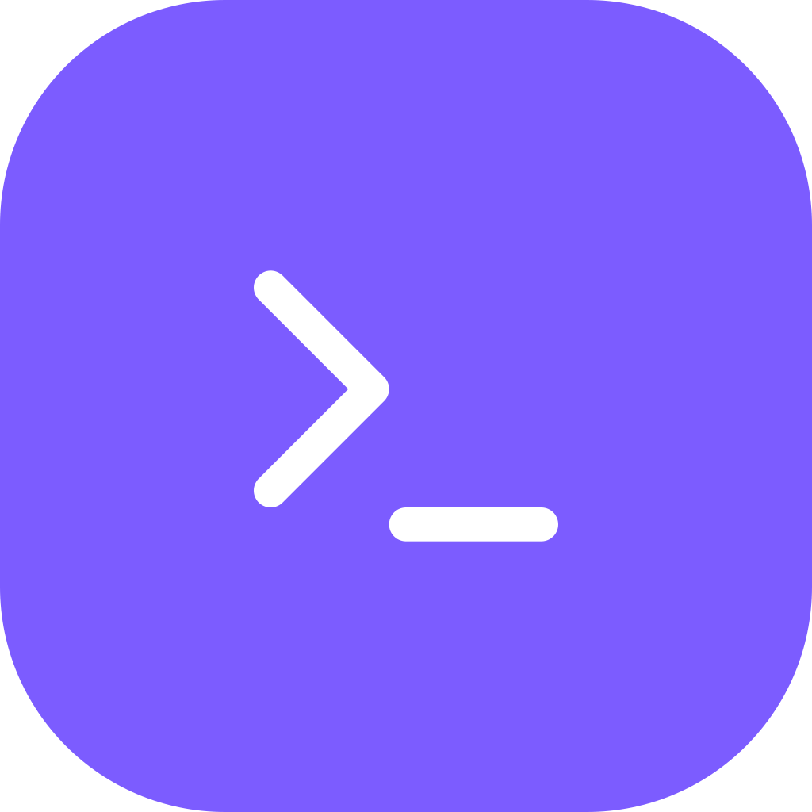

<p align="center">
  
</p>

<h1 align="center">will-terminal</h1>

<p align="center">Terminal com abas e painéis estilo tmux, feito com Tauri, React e Rust.</p>

## Funcionalidades

- Abas e painéis divididos, redimensionáveis com o mouse
- Teclas do tmux: prefixo `Ctrl+B`, depois `%` `"` `c` `x` `z` `n` `p` `o`, setas e `1-9` (`Ctrl+B ?` mostra todas)
- PowerShell, PowerShell 7, cmd, Git Bash ou WSL (escolha na barra de status)
- Painel e aba novos abrem na pasta do painel atual
- Renomear aba: duplo clique ou `Ctrl+B ,`
- `Ctrl+C` com texto selecionado copia, `Ctrl+V` cola; botão direito copia a seleção ou cola
- `Ctrl+clique` em links abre no navegador
- `Ctrl +`, `Ctrl -` e `Ctrl 0` mudam o tamanho da fonte
- Estado do último comando em cada painel (executando, ok, código de erro) e na aba; notificação do Windows quando um comando de mais de 10s termina numa aba escondida ou com o app em segundo plano
- Ponto na aba quando um painel escondido imprime algo
- Alternar o arranjo dos painéis: `Ctrl+B Espaço` (lado a lado, empilhados, um grande + pilha)
- Projetos: escolha uma pasta de projetos e `Ctrl+B f` lista as subpastas para abrir uma aba nelas
- Histórico de cópias: `Ctrl+B =` lista as últimas 10, `Ctrl+B ]` cola a mais recente (só na memória)
- Shell que termina com erro não some: o painel fica com a saída e o código, `Enter` reinicia. `Ctrl+B R` reinicia qualquer painel (mesma pasta, mesmo comando inicial)
- Gravar a saída de um painel em `.log` (texto puro): `Ctrl+B P` liga e desliga; os arquivos ficam em `%LOCALAPPDATA%\com.wiliammp.will-terminal\logs`
- Terminal flutuante por cima do layout: `Ctrl+B t` mostra e esconde, `exit` fecha
- Linha de comando: `will-terminal --perfil dev`, `--projeto will-repo`, `--cmd "npm test" --pasta .` (com o app aberto, a aba abre nele). O instalador coloca o app no PATH do usuário
- Paleta de comandos: `Ctrl+Shift+P` ou `Ctrl+B :`
- Busca no terminal, rolagem inclusa: `Ctrl+Shift+F`
- Modo cópia: `Ctrl+B [`, rolar com setas/`j`/`k`/PgUp/PgDn, `Enter` copia a seleção, `q` sai
- Digitar em todos os painéis da aba ao mesmo tempo (pela paleta)
- Trocar painéis de lugar: `Ctrl+B {` e `}`
- Reabre com as mesmas abas, painéis, pastas e shells
- Fechar a janela só esconde o app na bandeja: os terminais continuam rodando e abrir o app de novo volta para eles (`Ctrl+B d` faz o mesmo, como o detach do tmux). Para sair: bandeja → Sair
- Perfis: uma aba pronta com pasta, shell, arranjo dos painéis, variáveis de ambiente e um comando por painel (seta ao lado do `+`)
- Atualização automática pelas releases do GitHub
- Configurações: prefixo (`Ctrl+B`, `Ctrl+A` ou `Ctrl+Espaço`), tema e shell
- Tema claro e escuro, seguindo o sistema ou escolhido

## Como rodar

```bash
npm install
npm run tauri dev
```

Instalador: `npm run tauri build` (fica em `src-tauri/target/release/bundle/`).

## Testar no app de verdade

`node scripts/run-debug.mjs` abre uma cópia de teste com a porta de depuração do WebView2, e `node scripts/drive.mjs` a controla (teclas, cliques, capturas de tela). Detalhes em `.claude/skills/run-will-terminal/SKILL.md`.

## Release

Crie uma tag de versão e envie: `git tag v0.2.0 && git push origin v0.2.0`. O workflow `release.yml` gera o instalador, assina para o atualizador e publica a release.

Segredos do repositório no GitHub (Settings → Secrets → Actions):

- `TAURI_SIGNING_PRIVATE_KEY`: conteúdo de `~/.tauri/will-terminal.key`
- `TAURI_SIGNING_PRIVATE_KEY_PASSWORD`: não precisa (a chave foi gerada sem senha)

Lembre de subir a versão em `package.json`, `src-tauri/Cargo.toml` e `src-tauri/tauri.conf.json`.

## Licença

[MIT](LICENSE)
